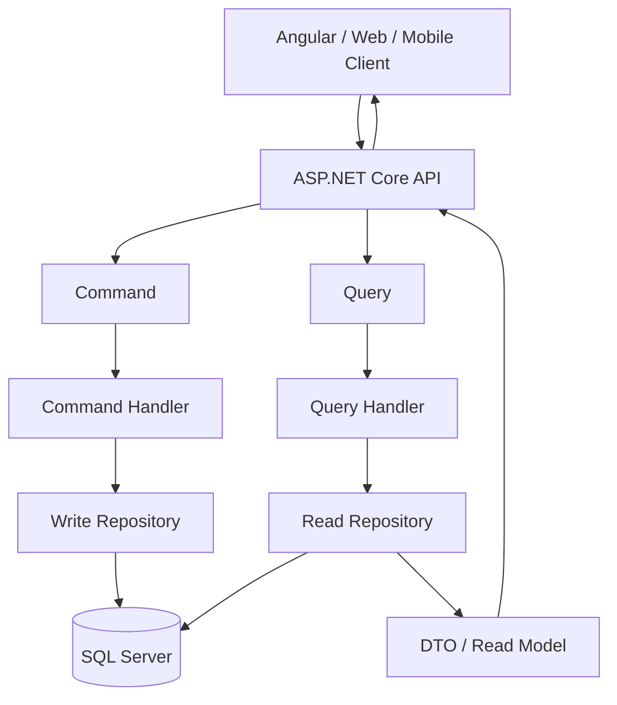
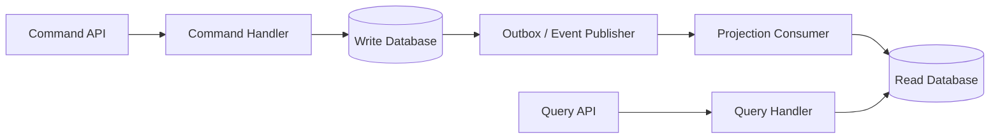

# Chapter ০৮: CQRS

# CQRS (Command Query Responsibility Segregation)

> **সহজ ভাষায়:** Command দিয়ে system-এর data পরিবর্তন করা হয়, আর Query দিয়ে data পড়া হয়। CQRS এই দুই ধরনের কাজের দায়িত্ব আলাদা রাখে।

এই README-তে CQRS-এর ধারণা, কেন ব্যবহার করা হয়, architecture, practical example এবং ASP.NET Core 8 + ADO.NET + SQL Server দিয়ে একটি professional-style implementation দেখানো হয়েছে।

---

## সূচিপত্র

- [১. CQRS কী?](#১-cqrs-কী)
- [২. Command ও Query কী?](#২-command-ও-query-কী)
- [৩. CQRS কেন ব্যবহার করা হয়?](#৩-cqrs-কেন-ব্যবহার-করা-হয়)
- [৪. CQRS কীভাবে কাজ করে?](#৪-cqrs-কীভাবে-কাজ-করে)
- [৫. Practical example: Bus Position Solution](#৫-practical-example-bus-position-solution)
- [৬. CQRS এবং Clean Architecture](#৬-cqrs-এবং-clean-architecture)
- [৭. Project structure](#৭-project-structure)
- [৮. Step-by-step implementation](#৮-step-by-step-implementation)
- [৯. API test](#৯-api-test)
- [১০. Professional best practices](#১০-professional-best-practices)
- [১১. CQRS-এর সঙ্গে MediatR](#১১-cqrs-এর-সঙ্গে-mediatr)
- [১২. CQRS বনাম related concepts](#১২-cqrs-বনাম-related-concepts)
- [১৩. কখন CQRS ব্যবহার করা উচিত নয়?](#১৩-কখন-cqrs-ব্যবহার-করা-উচিত-নয়)
- [১৪. Production checklist](#১৪-production-checklist)
- [১৫. সারসংক্ষেপ](#১৫-সারসংক্ষেপ)

---

## ১. CQRS কী?

CQRS-এর পূর্ণরূপ **Command Query Responsibility Segregation**।

এটি একটি architectural pattern, যেখানে application-এর data পরিবর্তন করার operation এবং data পড়ার operation আলাদা responsibility হিসেবে পরিচালিত হয়।

উদাহরণ হিসেবে একটি Bus Booking System চিন্তা করি। সেখানে:

- Admin নতুন trip তৈরি করে।
- Admin trip update বা delete করে।
- Customer trip list দেখে।
- Customer trip-এর details দেখে।
- Customer seat booking করে।

এগুলোকে দুটি প্রধান ভাগে ভাগ করা যায়:

1. **Write operations:** Create, Update, Delete
2. **Read operations:** List, Search, Details

CQRS-এর মূল নীতি:

> **A Command changes state. A Query returns data without changing state.**

অর্থাৎ:

- `CreateTripCommand` — নতুন trip তৈরি করে।
- `UpdateTripCommand` — trip update করে।
- `DeleteTripCommand` — trip delete করে।
- `GetTripsQuery` — trip list পড়ে।
- `GetTripByIdQuery` — একটি trip-এর details পড়ে।

শুধু method-এর নাম আলাদা করাই CQRS নয়। মূল বিষয় হলো Command এবং Query-এর handling responsibility ও model আলাদা রাখা।

## ২. Command ও Query কী?

### Command

Command হলো এমন একটি request, যা application-এর state পরিবর্তনের নির্দেশ দেয়।

উদাহরণ:

```csharp
public sealed record CreateTripCommand(
    string RouteName,
    decimal Fare,
    DateTime DepartureAt
);
```

এটি শুধু input data বহন করে। Command নিজে database-এ data insert করে না; Command Handler সেই কাজ পরিচালনা করে।

সাধারণ বৈশিষ্ট্য:

- Create, Update, Delete-এর মতো operation।
- Validation এবং business rules প্রযোজ্য হতে পারে।
- Authorization প্রয়োজন হতে পারে।
- Database state পরিবর্তিত হতে পারে।
- Operation সফল বা ব্যর্থ হওয়ার ফলাফল থাকে।

### Query

Query হলো data পড়ার request। এটি application-এর state পরিবর্তন করবে না।

```csharp
public sealed record GetTripsQuery;
```

Query Handler database থেকে data পড়ে DTO বা read model return করতে পারে।

সাধারণ বৈশিষ্ট্য:

- List, Search, Filter, Details-এর মতো operation।
- Data insert, update বা delete করবে না।
- Pagination এবং filtering ব্যবহার করতে পারে।
- Read-এর জন্য optimized projection ব্যবহার করা যায়।

### Command বনাম Query

| বিষয় | Command | Query |
|---|---|---|
| উদ্দেশ্য | State পরিবর্তন | Data পড়া |
| উদাহরণ | `CreateTripCommand` | `GetTripsQuery` |
| HTTP method-এর সাধারণ উদাহরণ | POST, PUT, PATCH, DELETE | GET |
| Validation | Business rules-সহ প্রয়োজন হতে পারে | Input/filter validation প্রয়োজন হতে পারে |
| Return value | ID, result, status বা DTO | DTO/read model/list |
| Database | সাধারণত write operation | সাধারণত read operation |

HTTP method এবং CQRS command/query এক জিনিস নয়; এগুলো সাধারণ mapping মাত্র। একটি Command-এর জন্য আলাদা request DTO ব্যবহার করা গেলেও সেটিই একা CQRS architecture প্রমাণ করে না।

---

## ৩. CQRS কেন ব্যবহার করা হয়?

### ৩.১ Separation of concerns

Read এবং Write-এর logic আলাদা থাকে। ফলে একটি handler-এ একাধিক ধরনের responsibility জমে যায় না।

### ৩.২ Business rules নিয়ন্ত্রণ

Trip তৈরি করার সময় fare, route, departure time, permission এবং seat capacity-এর মতো নিয়ম Command Handler বা domain model-এর মাধ্যমে প্রয়োগ করা যায়।

### ৩.৩ Read performance optimization

Query-তে প্রয়োজনীয় column-গুলোই select করা, pagination, filtering, caching এবং read replica ব্যবহার করা সহজ হয়।

### ৩.৪ Write integrity

Command-এর ক্ষেত্রে transaction, concurrency control, authorization এবং domain invariants-এর দিকে আলাদাভাবে মনোযোগ দেওয়া যায়।

### ৩.৫ Testing ও maintenance

Command এবং Query আলাদাভাবে test করা যায়। একটি read query পরিবর্তন করার সময় write logic-এর সঙ্গে অপ্রয়োজনীয় coupling কমে।

### ৩.৬ Independent scaling-এর সুযোগ

Advanced architecture-এ read ও write workload আলাদাভাবে scale করা সম্ভব। তবে এর জন্য আলাদা read model, replica বা infrastructure প্রয়োজন হতে পারে।

### কখন CQRS উপকারী?

- Business rules জটিল।
- Read এবং Write workload-এর ধরন আলাদা।
- Read response-এর জন্য optimized projection দরকার।
- Domain-specific command-এর সংখ্যা বাড়ছে।
- System-এর maintainability ও testing গুরুত্বপূর্ণ।

CQRS performance স্বয়ংক্রিয়ভাবে বাড়ায় না। Design সঠিক না হলে বরং complexity বাড়তে পারে।

---

## ৪. CQRS কীভাবে কাজ করে?

### Logical architecture



এই diagram-এ Read এবং Write-এর application-level responsibility আলাদা, কিন্তু একই SQL Server database ব্যবহার করা হচ্ছে।

এটাই একটি গুরুত্বপূর্ণ বিষয়: **CQRS ব্যবহার করতে শুরুতেই আলাদা database বাধ্যতামূলক নয়।**

### Command flow

1. Client `POST /api/v1/trips` request পাঠায়।
2. API request থেকে `CreateTripCommand` তৈরি করে।
3. Command Handler input validation ও business rules যাচাই করে।
4. Repository database operation করে।
5. Database সফল হলে Handler result ফেরত দেয়।
6. API `201 Created` response পাঠায়।

### Query flow

1. Client `GET /api/v1/trips` request পাঠায়।
2. API `GetTripsQuery` dispatch করে।
3. Query Handler read repository-কে call করে।
4. Repository database থেকে প্রয়োজনীয় data পড়ে।
5. Handler DTO/list ফেরত দেয়।
6. API `200 OK` response পাঠায়।

### Advanced: Separate Read Database



এই architecture-এ read database update হতে কিছু সময় লাগতে পারে। তাই একে eventual consistency-এর design হিসেবে বিবেচনা করতে হয়। Event publishing, retry, duplicate handling, idempotency এবং projection recovery-এর পরিকল্পনা প্রয়োজন।

---

## ৫. Practical example: Bus Position Solution

ধরা যাক, BPS application-এ Trips feature তৈরি করছি।

### প্রয়োজনীয় operations

| Feature | Type | Request |
|---|---|---|
| নতুন trip তৈরি | Command | `CreateTripCommand` |
| Trip update | Command | `UpdateTripCommand` |
| একাধিক trip delete | Command | `DeleteTripsCommand` |
| সব trip দেখা | Query | `GetTripsQuery` |
| ID দিয়ে trip দেখা | Query | `GetTripByIdQuery` |
| Search/filter | Query | `SearchTripsQuery` |

এই README-তে `CreateTripCommand` এবং `GetTripsQuery` implement করা হবে। অন্য operation-গুলো একই design pattern অনুসরণ করবে, তবে প্রকৃত business rules অনুযায়ী আলাদা handler ও validation প্রয়োজন হবে।

---

## ৬. CQRS এবং Clean Architecture

এগুলো একে অপরের বিকল্প নয়।

| বিষয় | দায়িত্ব |
|---|---|
| CQRS | Command ও Query-এর responsibility আলাদা করা |
| Clean Architecture | Layer boundary ও dependency direction নির্ধারণ করা |
| MediatR | Request-কে উপযুক্ত handler-এ dispatch করতে সাহায্য করা |
| Microservices | System-কে আলাদা deployable services-এ ভাগ করা |

একটি monolithic ASP.NET Core application-এর মধ্যেই CQRS ব্যবহার করা যায়। CQRS-এর জন্য Microservices বাধ্যতামূলক নয়।

---

## ৭. Project structure

Visual Studio-তে একটি solution-এর মধ্যে নিচের structure ব্যবহার করা যেতে পারে:

```text
BPS.sln
├── BPS.Domain
├── BPS.Application
│   └── Features
│       └── Trips
│           ├── DTOs
│           │   └── TripDto.cs
│           ├── Abstractions
│           │   └── ITripRepository.cs
│           ├── Commands
│           │   └── CreateTrip
│           │       ├── CreateTripCommand.cs
│           │       └── CreateTripCommandHandler.cs
│           └── Queries
│               └── GetTrips
│                   ├── GetTripsQuery.cs
│                   └── GetTripsQueryHandler.cs
├── BPS.Infrastructure
│   └── Persistence
│       └── Repositories
│           └── TripRepository.cs
└── BPS.API
    ├── Controllers
    │   └── TripsController.cs
    ├── Program.cs
    └── appsettings.json
```

### Layer-এর দায়িত্ব

- **Domain:** Core entities, value objects এবং domain rules।
- **Application:** Commands, Queries, Handlers, DTOs এবং interfaces।
- **Infrastructure:** ADO.NET, SQL Server এবং repository implementations।
- **API:** HTTP endpoints, authentication, authorization এবং response mapping।

Application layer-এর মধ্যে সরাসরি `SqlConnection` ব্যবহার না করে interface-এর মাধ্যমে Infrastructure layer-এর সঙ্গে যোগাযোগ রাখা হবে।

---

## ৮. Step-by-step implementation

### Step 1: SQL Server table তৈরি

এটি একটি illustrative schema। Existing BPS database-এ `Trips` table থাকলে নিজের schema-এর সঙ্গে Stored Procedure ও mapping মিলিয়ে নিতে হবে।

```sql
CREATE TABLE dbo.Trips
(
    Id          INT IDENTITY(1,1) PRIMARY KEY,
    RouteName   NVARCHAR(150) NOT NULL,
    Fare        DECIMAL(10,2) NOT NULL,
    DepartureAt DATETIME2 NOT NULL,
    CreatedAt   DATETIME2 NOT NULL
        CONSTRAINT DF_Trips_CreatedAt DEFAULT SYSUTCDATETIME(),

    CONSTRAINT CK_Trips_Fare CHECK (Fare >= 0)
);
GO
```

### Step 2: Create Stored Procedure

```sql
CREATE OR ALTER PROCEDURE dbo.SP_Trip_Create
    @RouteName NVARCHAR(150),
    @Fare DECIMAL(10,2),
    @DepartureAt DATETIME2
AS
BEGIN
    SET NOCOUNT ON;
    SET XACT_ABORT ON;

    IF NULLIF(LTRIM(RTRIM(@RouteName)), N'') IS NULL
        THROW 50001, 'Route name is required.', 1;

    IF @Fare < 0
        THROW 50002, 'Fare cannot be negative.', 1;

    INSERT INTO dbo.Trips
        (RouteName, Fare, DepartureAt)
    VALUES
        (@RouteName, @Fare, @DepartureAt);

    SELECT
        Id, RouteName, Fare, DepartureAt, CreatedAt
    FROM dbo.Trips
    WHERE Id = CONVERT(INT, SCOPE_IDENTITY());
END;
GO
```

### Step 3: Get all trips Stored Procedure

```sql
CREATE OR ALTER PROCEDURE dbo.SP_Trip_GetAll
AS
BEGIN
    SET NOCOUNT ON;

    SELECT Id, RouteName, Fare, DepartureAt, CreatedAt
    FROM dbo.Trips
    ORDER BY DepartureAt DESC, Id DESC;
END;
GO
```

> Stored Procedure আলাদা করলেই CQRS হয় না। CQRS-এর মূল separation Application layer-এর Command/Query এবং Handler-এ।

### Step 4: DTO তৈরি

`BPS.Application/Features/Trips/DTOs/TripDto.cs`

```csharp
namespace BPS.Application.Features.Trips.DTOs;

public sealed record TripDto(
    int Id,
    string RouteName,
    decimal Fare,
    DateTime DepartureAt,
    DateTime CreatedAt
);
```

DTO API response-এর shape নির্ধারণ করে। Database entity সরাসরি expose না করলে persistence model এবং API contract আলাদা রাখা যায়।

### Step 5: Repository abstraction

`BPS.Application/Features/Trips/Abstractions/ITripRepository.cs`

```csharp
using BPS.Application.Features.Trips.DTOs;

namespace BPS.Application.Features.Trips.Abstractions;

public interface ITripRepository
{
    Task<TripDto> CreateAsync(
        string routeName,
        decimal fare,
        DateTime departureAt,
        CancellationToken cancellationToken);

    Task<IReadOnlyList<TripDto>> GetAllAsync(
        CancellationToken cancellationToken);
}
```

### Step 6: CreateTripCommand

`BPS.Application/Features/Trips/Commands/CreateTrip/CreateTripCommand.cs`

```csharp
namespace BPS.Application.Features.Trips.Commands.CreateTrip;

public sealed record CreateTripCommand(
    string RouteName,
    decimal Fare,
    DateTime DepartureAt
);
```

Command হলো request data; database operation করবে Handler থেকে call করা repository।

### Step 7: CreateTripCommandHandler

`BPS.Application/Features/Trips/Commands/CreateTrip/CreateTripCommandHandler.cs`

```csharp
using BPS.Application.Features.Trips.Abstractions;
using BPS.Application.Features.Trips.DTOs;

namespace BPS.Application.Features.Trips.Commands.CreateTrip;

public sealed class CreateTripCommandHandler
{
    private readonly ITripRepository _repository;

    public CreateTripCommandHandler(ITripRepository repository)
    {
        _repository = repository;
    }

    public async Task<TripDto> Handle(
        CreateTripCommand command,
        CancellationToken cancellationToken)
    {
        if (string.IsNullOrWhiteSpace(command.RouteName))
            throw new ArgumentException("Route name is required.");

        if (command.Fare < 0)
            throw new ArgumentException("Fare cannot be negative.");

        if (command.DepartureAt <= DateTime.UtcNow)
            throw new ArgumentException(
                "Departure time must be in the future.");

        return await _repository.CreateAsync(
            command.RouteName.Trim(),
            command.Fare,
            command.DepartureAt,
            cancellationToken);
    }
}
```

এটি একটি teaching example। Production-এ raw `ArgumentException`-এর পরিবর্তে application-specific validation result/exception এবং centralized exception mapping ব্যবহার করা ভালো। Time handling-এর জন্য UTC convention বা `DateTimeOffset` ব্যবহার করার নীতি নির্ধারণ করো।

BPS-এর বাস্তব domain-এ route ID, business/branch ownership, seat capacity এবং trip scheduling-এর নিয়মও যাচাই করতে হবে।

### Step 8: GetTripsQuery

`BPS.Application/Features/Trips/Queries/GetTrips/GetTripsQuery.cs`

```csharp
namespace BPS.Application.Features.Trips.Queries.GetTrips;

public sealed record GetTripsQuery;
```

### Step 9: GetTripsQueryHandler

`BPS.Application/Features/Trips/Queries/GetTrips/GetTripsQueryHandler.cs`

```csharp
using BPS.Application.Features.Trips.Abstractions;
using BPS.Application.Features.Trips.DTOs;

namespace BPS.Application.Features.Trips.Queries.GetTrips;

public sealed class GetTripsQueryHandler
{
    private readonly ITripRepository _repository;

    public GetTripsQueryHandler(ITripRepository repository)
    {
        _repository = repository;
    }

    public Task<IReadOnlyList<TripDto>> Handle(
        GetTripsQuery query,
        CancellationToken cancellationToken)
    {
        return _repository.GetAllAsync(cancellationToken);
    }
}
```

Query Handler data read করবে, state পরিবর্তন করবে না। বড় dataset-এর জন্য Query-তে pagination ও filtering যোগ করতে হবে।

### Step 10: ADO.NET repository implementation

NuGet package:

```text
Microsoft.Data.SqlClient
```

`BPS.Infrastructure/Persistence/Repositories/TripRepository.cs`

```csharp
using System.Data;
using BPS.Application.Features.Trips.Abstractions;
using BPS.Application.Features.Trips.DTOs;
using Microsoft.Data.SqlClient;
using Microsoft.Extensions.Configuration;

namespace BPS.Infrastructure.Persistence.Repositories;

public sealed class TripRepository : ITripRepository
{
    private readonly string _connectionString;

    public TripRepository(IConfiguration configuration)
    {
        _connectionString =
            configuration.GetConnectionString("BPS")
            ?? throw new InvalidOperationException(
                "BPS connection string is missing.");
    }

    public async Task<TripDto> CreateAsync(
        string routeName,
        decimal fare,
        DateTime departureAt,
        CancellationToken cancellationToken)
    {
        await using var connection =
            new SqlConnection(_connectionString);

        await using var command =
            new SqlCommand("dbo.SP_Trip_Create", connection)
            {
                CommandType = CommandType.StoredProcedure
            };

        command.Parameters.Add(
            "@RouteName", SqlDbType.NVarChar, 150).Value = routeName;

        var fareParameter = command.Parameters.Add(
            "@Fare", SqlDbType.Decimal);

        fareParameter.Precision = 10;
        fareParameter.Scale = 2;
        fareParameter.Value = fare;

        command.Parameters.Add(
            "@DepartureAt", SqlDbType.DateTime2).Value = departureAt;

        await connection.OpenAsync(cancellationToken);

        await using var reader =
            await command.ExecuteReaderAsync(cancellationToken);

        if (!await reader.ReadAsync(cancellationToken))
            throw new InvalidOperationException(
                "Created trip was not returned.");

        return MapTrip(reader);
    }

    public async Task<IReadOnlyList<TripDto>> GetAllAsync(
        CancellationToken cancellationToken)
    {
        var trips = new List<TripDto>();

        await using var connection =
            new SqlConnection(_connectionString);

        await using var command =
            new SqlCommand("dbo.SP_Trip_GetAll", connection)
            {
                CommandType = CommandType.StoredProcedure
            };

        await connection.OpenAsync(cancellationToken);

        await using var reader =
            await command.ExecuteReaderAsync(cancellationToken);

        while (await reader.ReadAsync(cancellationToken))
            trips.Add(MapTrip(reader));

        return trips;
    }

    private static TripDto MapTrip(SqlDataReader reader)
    {
        return new TripDto(
            reader.GetInt32(reader.GetOrdinal("Id")),
            reader.GetString(reader.GetOrdinal("RouteName")),
            reader.GetDecimal(reader.GetOrdinal("Fare")),
            reader.GetDateTime(reader.GetOrdinal("DepartureAt")),
            reader.GetDateTime(reader.GetOrdinal("CreatedAt"))
        );
    }
}
```

এই repository implementation-এ:

- Parameterized stored procedure call ব্যবহার করা হয়েছে।
- `async/await` ও `CancellationToken` ব্যবহার করা হয়েছে।
- `SqlConnection`, `SqlCommand` এবং `SqlDataReader` dispose করা হয়েছে।
- Read result DTO-তে map করা হয়েছে।

### Step 11: Connection string

`BPS.API/appsettings.json`-এর development example:

```json
{
  "ConnectionStrings": {
    "BPS": "Server=YOUR_SERVER;Database=BPS;Integrated Security=True;TrustServerCertificate=True"
  }
}
```

নিজের SQL Server environment অনুযায়ী connection string পরিবর্তন করো। Production-এ credentials source control-এ commit করবে না। Secret manager বা environment variables ব্যবহার করো। `TrustServerCertificate=True` production certificate validation-এর বিকল্প নয়।

### Step 12: API Controller

`BPS.API/Controllers/TripsController.cs`

```csharp
using BPS.Application.Features.Trips.Commands.CreateTrip;
using BPS.Application.Features.Trips.Queries.GetTrips;
using Microsoft.AspNetCore.Mvc;

namespace BPS.API.Controllers;

[ApiController]
[Route("api/v1/trips")]
public sealed class TripsController : ControllerBase
{
    private readonly CreateTripCommandHandler _createHandler;
    private readonly GetTripsQueryHandler _getHandler;

    public TripsController(
        CreateTripCommandHandler createHandler,
        GetTripsQueryHandler getHandler)
    {
        _createHandler = createHandler;
        _getHandler = getHandler;
    }

    [HttpPost]
    public async Task<IActionResult> Create(
        [FromBody] CreateTripCommand command,
        CancellationToken cancellationToken)
    {
        var trip = await _createHandler.Handle(
            command, cancellationToken);

        return Created($"/api/v1/trips/{trip.Id}", trip);
    }

    [HttpGet]
    public async Task<IActionResult> GetAll(
        CancellationToken cancellationToken)
    {
        var trips = await _getHandler.Handle(
            new GetTripsQuery(), cancellationToken);

        return Ok(trips);
    }
}
```

Production application-এ controller-এ authentication/authorization policies, consistent error handling, API versioning strategy এবং pagination contract-ও যুক্ত করতে হবে। Controller-এর route ও response contract তোমার existing API convention-এর সঙ্গে মিলিয়ে নাও।

### Step 13: Dependency Injection

`BPS.API/Program.cs`-এ প্রয়োজনীয় registrations:

```csharp
using BPS.Application.Features.Trips.Abstractions;
using BPS.Application.Features.Trips.Commands.CreateTrip;
using BPS.Application.Features.Trips.Queries.GetTrips;
using BPS.Infrastructure.Persistence.Repositories;

var builder = WebApplication.CreateBuilder(args);

builder.Services.AddControllers();

builder.Services.AddScoped<ITripRepository, TripRepository>();
builder.Services.AddScoped<CreateTripCommandHandler>();
builder.Services.AddScoped<GetTripsQueryHandler>();

var app = builder.Build();

app.MapControllers();

app.Run();
```

এটি minimal example। Existing application-এ `AddAuthentication`, `AddAuthorization`, middleware, Swagger, health checks এবং অন্যান্য registrations থাকলে সেগুলো অক্ষুণ্ণ রাখবে। বড় solution-এ `AddApplication()` ও `AddInfrastructure()` extension methods দিয়ে registration সংগঠিত করা যায়।

---

## ৯. API test

API run করার পর Swagger বা Postman দিয়ে test করো।

### Create Trip — Command

**Request**

```http
POST /api/v1/trips
Content-Type: application/json
```

```json
{
  "routeName": "Dhaka to Chittagong",
  "fare": 750.00,
  "departureAt": "2026-10-20T08:00:00Z"
}
```

সফল হলে API `201 Created` এবং তৈরি হওয়া Trip DTO ফেরত দেবে।

### Get Trips — Query

**Request**

```http
GET /api/v1/trips
```

সফল হলে API `200 OK` এবং trip list ফেরত দেবে।

### Expected flow

```text
POST /api/v1/trips
    ↓
CreateTripCommand
    ↓
CreateTripCommandHandler
    ↓
ITripRepository
    ↓
TripRepository
    ↓
SP_Trip_Create
    ↓
SQL Server
    ↓
201 Created + TripDto
```

```text
GET /api/v1/trips
    ↓
GetTripsQuery
    ↓
GetTripsQueryHandler
    ↓
ITripRepository
    ↓
TripRepository
    ↓
SP_Trip_GetAll
    ↓
SQL Server
    ↓
200 OK + TripDto[]
```

**গুরুত্বপূর্ণ:** এই উদাহরণটি CQRS-এর basic implementation শেখানোর জন্য। এটি copy-paste করলেই সম্পূর্ণ production-ready booking system হয়ে যায় না। Production deployment-এর আগে validation error mapping, authorization, pagination, logging, integration tests, configuration security এবং domain-specific business rules যোগ করতে হবে।

---

## ১০. Professional best practices

### ১০.১ Validation

FluentValidation বা সমমানের validation mechanism ব্যবহার করে Command-এর input যাচাই করা যায়। API-তে invalid request-এর জন্য consistent `400 Bad Request` response দিতে হবে।

Application validation এবং database constraints উভয়ই প্রয়োজন হতে পারে। Database constraints data integrity নিশ্চিত করতে সাহায্য করে।

### ১০.২ Authorization

শুধু Angular UI-তে button hide করলে নিরাপত্তা নিশ্চিত হয় না। API-তে authorization policy enforce করতে হবে।

উদাহরণ:

```csharp
[Authorize(Roles = "Admin")]
[HttpPost]
public async Task<IActionResult> Create(...)
{
    // Command dispatch
}
```

এটি illustrative snippet; প্রয়োজনীয় `using`, method parameters এবং handler call সম্পূর্ণ controller-এর সঙ্গে মিলিয়ে নিতে হবে।

### ১০.৩ Transaction

একটি business operation-এ একাধিক database write পরস্পরের ওপর নির্ভরশীল হলে সেগুলো transaction-এর মধ্যে করতে হতে পারে।

যেমন booking confirm করার সময় booking record এবং outbox event একই transaction-এ persist করা যায়। Transaction-এর বাইরে message publish করলে failure window তৈরি হতে পারে; এ ক্ষেত্রে Transactional Outbox pattern বিবেচনা করো।

### ১০.৪ Concurrency

একাধিক customer একই seat বুক করতে চাইলে শুধু CQRS ব্যবহার করলেই race condition সমাধান হবে না। Atomic database update, locking strategy, unique constraints এবং transaction isolation সঠিকভাবে design করতে হবে।

### ১০.৫ Pagination ও filtering

বড় dataset-এর ক্ষেত্রে Query-তে `PageNumber`, `PageSize`, `SearchTerm`, date range এবং প্রয়োজনীয় filters যোগ করো। SQL-এ `OFFSET/FETCH` বা উপযুক্ত keyset pagination ব্যবহার করা যায়।

### ১০.৬ Error handling

Global exception handler ব্যবহার করে validation, not-found, conflict এবং unexpected server errors-এর জন্য consistent HTTP response দাও। Internal database details client-কে প্রকাশ করবে না।

### ১০.৭ Logging ও observability

Structured logging, correlation/trace ID এবং প্রয়োজন অনুযায়ী metrics ও distributed tracing ব্যবহার করো। Command-এর business outcome ও failure তদন্ত করা সহজ হবে।

### ১০.৮ Testing strategy

- **Unit tests:** Command validation, domain rules, Handler behavior।
- **Integration tests:** Repository, Stored Procedure এবং SQL Server interaction।
- **API tests:** Status code, response shape, authentication ও authorization।
- **Concurrency tests:** একই seat বা resource-এ simultaneous operation।

### ১০.৯ Read optimization

Query-তে শুধু প্রয়োজনীয় column select করো। Database index, execution plan, pagination এবং cache প্রয়োজন অনুযায়ী ব্যবহার করো। সব Query-র জন্য caching উপযুক্ত নয়; stale data গ্রহণযোগ্য কি না তা আগে ঠিক করতে হবে।

### ১০.১০ Idempotency

Payment, booking confirmation বা retry হতে পারে এমন command-এর ক্ষেত্রে duplicate request-এর প্রভাব বিবেচনা করো। প্রয়োজন হলে idempotency key, unique constraint এবং persisted operation result ব্যবহার করো।

### ১০.১১ Separate read model

Read ও Write-এর model আলাদা করা যায়, এমনকি একই database-এর মধ্যেও। আলাদা database ব্যবহার করলে data synchronization, event delivery, retry, duplicate events এবং eventual consistency-এর জটিলতা আসে।

### ১০.১২ Domain logic-এর সঠিক জায়গা

সব business logic Handler-এ জমা করা উচিত নয়। Domain invariant যদি Entity বা Domain Service-এর দায়িত্ব হয়, তাহলে সেটি Domain layer-এ রাখো। Handler orchestration করবে; domain model business rule enforce করবে।

---

## ১১. CQRS-এর সঙ্গে MediatR

MediatR হলো .NET ecosystem-এ ব্যবহৃত একটি library, যা request-কে উপযুক্ত handler-এ dispatch করতে সাহায্য করে।

MediatR ব্যবহার করলে Controller-এ সরাসরি Handler inject করার পরিবর্তে `ISender` বা `IMediator` দিয়ে request পাঠানো যায়।

Conceptual example:

```csharp
public sealed record GetTripsQuery
    : IRequest<IReadOnlyList<TripDto>>;
```

Handler:

```csharp
public sealed class GetTripsQueryHandler
    : IRequestHandler<GetTripsQuery, IReadOnlyList<TripDto>>
{
    // Inject repository and implement Handle(...)
}
```

Controller:

```csharp
var trips = await sender.Send(
    new GetTripsQuery(),
    cancellationToken);

return Ok(trips);
```

এটি concept দেখানোর snippet; compile করার জন্য MediatR package, interface implementation, DI registration এবং সম্পূর্ণ handler code প্রয়োজন হবে।

**মনে রাখবে:** MediatR নিজে CQRS নয়। MediatR ছাড়াও CQRS implement করা যায়। Library নির্বাচন করবে project-এর complexity, team convention এবং maintenance cost বিবেচনা করে।

---

## ১২. CQRS বনাম related concepts

| Concept | মূল উদ্দেশ্য | CQRS-এর সঙ্গে সম্পর্ক |
|---|---|---|
| Layered Architecture | Application-এর layer আলাদা করা | একসঙ্গে ব্যবহার করা যায় |
| Clean Architecture | Dependency direction নিয়ন্ত্রণ | CQRS-এর complementary architecture |
| Repository Pattern | Data access abstraction | Handler থেকে data access আলাদা করতে পারে |
| Mediator Pattern | Request dispatch ও coupling কমানো | CQRS handler dispatch করতে পারে |
| Domain-Driven Design | Complex business domain model করা | Complex command handling-এ উপকারী |
| Event-Driven Architecture | Event-এর মাধ্যমে component communicate করা | CQRS-এর সঙ্গে ব্যবহার করা যায়, কিন্তু বাধ্যতামূলক নয় |
| Microservices | Independently deployable services | CQRS monolith-এও সম্ভব |
| Event Sourcing | State change event হিসেবে persist করা | CQRS থেকে আলাদা pattern |

### CQRS বনাম Event Sourcing

CQRS মানে Read/Write responsibility আলাদা করা। Event Sourcing মানে state-এর পরিবর্তনগুলো event হিসেবে persist করা।

তুমি CQRS ব্যবহার করেও সাধারণ relational table-এ current state persist করতে পারো। Event Sourcing বাধ্যতামূলক নয়।

---

## ১৩. কখন CQRS ব্যবহার করা উচিত নয়?

CQRS সব application-এর জন্য সঠিক পছন্দ নয়।

নিচের ক্ষেত্রে সাধারণ CRUD service যথেষ্ট হতে পারে:

- ছোট application এবং সরল business rules।
- Read ও Write-এর model প্রায় একই।
- আলাদা optimization বা scaling-এর প্রয়োজন নেই।
- Team-এর জন্য অতিরিক্ত Handler, DTO এবং abstraction maintenance burden তৈরি করবে।

অপ্রয়োজনীয় CQRS class তৈরি করলে boilerplate বাড়ে এবং feature change করতে বেশি file পরিবর্তন করতে হতে পারে।

**Professional guideline:** প্রথমে problem এবং requirement বুঝে architecture বেছে নাও। Complexity-এর বাস্তব কারণ থাকলে CQRS প্রয়োগ করো।

---

## ১৪. Production checklist

Production-এ নেওয়ার আগে এই checklist ব্যবহার করো:

- [ ] Command ও Query-এর responsibility স্পষ্টভাবে আলাদা।
- [ ] Application layer Infrastructure implementation-এর ওপর সরাসরি নির্ভরশীল নয়।
- [ ] Request validation ও consistent error mapping আছে।
- [ ] Authentication ও authorization API-তে enforce করা হয়েছে।
- [ ] Database constraints ও transaction সঠিকভাবে design করা হয়েছে।
- [ ] Concurrent requests-এর জন্য প্রয়োজনীয় concurrency control আছে।
- [ ] Read endpoint-এ pagination ও filtering আছে।
- [ ] SQL access parameterized এবং secrets নিরাপদে configure করা হয়েছে।
- [ ] Unit, integration ও API tests লেখা হয়েছে।
- [ ] Structured logging ও প্রয়োজনীয় observability আছে।
- [ ] Retry ও duplicate command-এর behavior নির্ধারিত।
- [ ] Separate read database থাকলে consistency ও recovery strategy আছে।

---

## ১৫. সারসংক্ষেপ

CQRS-এর মূল কথা:

- **Command** system-এর state পরিবর্তন করে।
- **Query** data পড়ে, state পরিবর্তন করে না।
- CQRS application-এর Read ও Write responsibility আলাদা করে।
- CQRS, Clean Architecture, MediatR, Microservices এবং Event Sourcing আলাদা concept।
- CQRS implement করতে আলাদা database বা MediatR বাধ্যতামূলক নয়।
- ASP.NET Core + ADO.NET + SQL Server Stored Procedures দিয়েও CQRS implement করা যায়।
- Professional implementation-এর জন্য validation, authorization, transaction, concurrency control, testing এবং observability গুরুত্বপূর্ণ।
- Read/Write model বা database আলাদা করবে তখনই, যখন business requirement ও performance evidence তা justify করে।

> **Recommended learning path:** প্রথমে একই SQL Server database ব্যবহার করে Command ও Query Handler আলাদা করো। তারপর validation, pagination, transaction, authorization এবং testing যোগ করো। বাস্তব প্রয়োজন দেখা দিলে caching, read replicas, Outbox pattern এবং separate read model শিখে প্রয়োগ করো।

---

⬅️ [Message Queue ও EDA](07-message-queue-and-eda.md) | ➡️ [CAP Theorem](09-cap-theorem.md)
