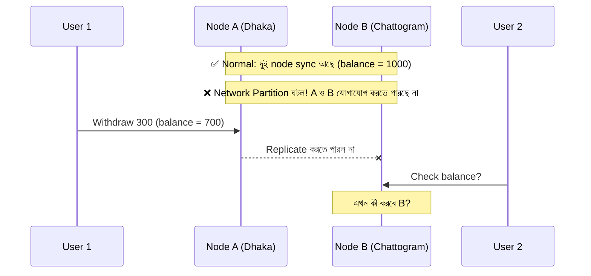

# Chapter ০৯: CAP Theorem

> Distributed system design এর সবচেয়ে গুরুত্বপূর্ণ theory গুলোর একটি। এই গাইডে CAP Theorem কী, কেন দরকার, কীভাবে এবং কখন ব্যবহার করবেন, এবং production-grade system এ এটি কীভাবে কাজে লাগে — সব উদাহরণসহ ব্যাখ্যা করা হয়েছে।

---

## সূচিপত্র

1. [CAP Theorem কী?](#1-cap-theorem-কী)
2. [C, A, P — তিনটি অক্ষরের মানে](#2-c-a-p--তিনটি-অক্ষরের-মানে)
3. [কেন তিনটি একসাথে পাওয়া যায় না?](#3-কেন-তিনটি-একসাথে-পাওয়া-যায়-না)
4. [CP, AP ও CA system](#4-cp-ap-ও-ca-system)
5. [কোন Database কোন category তে পড়ে?](#5-কোন-database-কোন-category-তে-পড়ে)
6. [Real-world উদাহরণ](#6-real-world-উদাহরণ)
7. [কখন CAP Theorem দরকার হয়?](#7-কখন-cap-theorem-দরকার-হয়)
8. [Professional-grade ব্যবহার: Step by Step](#8-professional-grade-ব্যবহার-step-by-step)
9. [Tunable Consistency ও Quorum](#9-tunable-consistency-ও-quorum)
10. [C# Code Example (Simulation)](#10-c-code-example-simulation)
11. [PACELC — CAP এর পরের ধাপ](#11-pacelc--cap-এর-পরের-ধাপ)
12. [সাধারণ ভুল ধারণা](#12-সাধারণ-ভুল-ধারণা)
13. [Quick Summary ও Interview Cheat Sheet](#13-quick-summary-ও-interview-cheat-sheet)

---

## 1. CAP Theorem কী?

**CAP Theorem** প্রথম প্রস্তাব করেন **Eric Brewer (২০০০ সালে)**, পরে **Seth Gilbert ও Nancy Lynch (২০০২ সালে)** এটি গাণিতিকভাবে প্রমাণ করেন।

> **সংজ্ঞা:** একটি distributed data system এ **Network Partition** ঘটলে, system **Consistency (C)** আর **Availability (A)** — এই দুইটির মধ্যে **একটি** বেছে নিতে হয়। দুইটি একসাথে পুরোপুরি দেওয়া সম্ভব নয়।

সহজ কথায়: যখন একাধিক server (node) মিলে একটি system চালায়, আর তাদের মধ্যকার network সংযোগ কেটে যায়, তখন হয় আপনি **সঠিক data** দেবেন (কিন্তু কিছু request reject করবেন), নয়তো **সবসময় উত্তর** দেবেন (কিন্তু উত্তর পুরনো/ভুল হতে পারে)।

---

## 2. C, A, P — তিনটি অক্ষরের মানে

| অক্ষর | নাম | অর্থ |
|---|---|---|
| **C** | Consistency | প্রতিটি read হয় সর্বশেষ write এর data পাবে, অথবা error পাবে। সব node এ সবাই একই data "দেখে"। |
| **A** | Availability | যেকোনো সচল (non-failing) node এ পাঠানো প্রতিটি request এর একটি **non-error response** আসবে (সর্বশেষ data হওয়ার নিশ্চয়তা ছাড়া)। |
| **P** | Partition Tolerance | node গুলোর মধ্যে network ছিঁড়ে গেলে বা message হারালেও system চলতে থাকবে। |

> ⚠️ **সতর্কতা:** CAP এর **C** আর ACID এর **C** এক জিনিস নয়।
> - **ACID Consistency** = database এর rule/constraint (foreign key, unique ইত্যাদি) ভঙ্গ হবে না।
> - **CAP Consistency** = সব node এ একই (latest) data দেখা, যাকে *linearizability* বলা হয়।

---

## 3. কেন তিনটি একসাথে পাওয়া যায় না?

### বাস্তবতা: Partition এড়ানো যায় না

Distributed system এ network কখনো না কখনো fail করবেই (cable কাটা, switch নষ্ট, data center এর মধ্যে সংযোগ বিচ্ছিন্ন, packet loss)। তাই **P বাধ্যতামূলক** ধরে নিতে হয়। আসল প্রশ্ন হলো: **Partition হলে C নাকি A — কোনটা বাঁচাবেন?**

### Step by Step উদাহরণ

ধরুন একটি ব্যাংকের দুইটি database node আছে: **Node A (Dhaka)** ও **Node B (Chattogram)**। দুইটিতেই `balance = 1000`।



**Step 1:** Partition এর আগে দুই node এ `balance = 1000`।

**Step 2:** Partition ঘটল। A ও B পরস্পরকে message পাঠাতে পারছে না।

**Step 3:** User 1, Node A তে ৩০০ টাকা তুলল। A এখন `700` জানে, কিন্তু B এখনও `1000` জানে।

**Step 4:** User 2, Node B কে balance জিজ্ঞেস করল। B এর সামনে দুইটি পথ:

| পথ | B কী করে | ফলাফল |
|---|---|---|
| **CP (Consistency বেছে নেওয়া)** | Error / timeout দেয়: "এখন নিশ্চিত হতে পারছি না" | Data ভুল দেখায় না, কিন্তু B **unavailable** |
| **AP (Availability বেছে নেওয়া)** | `1000` দেখায় (পুরনো data) | Response পায়, কিন্তু data **inconsistent** |

**Step 5:** Partition ঠিক হলে AP system এ node গুলো নিজেদের data মিলিয়ে নেয় (*reconciliation*), একেই বলে **Eventual Consistency**।

---

## 4. CP, AP ও CA system

### 🔵 CP (Consistency + Partition Tolerance)
- Partition এর সময় inconsistent data দেওয়ার চেয়ে request reject/timeout করে।
- **কখন:** টাকাপয়সা, inventory এর শেষ stock, seat booking, leader election, distributed lock।

### 🟢 AP (Availability + Partition Tolerance)
- Partition এর সময়ও সবসময় সাড়া দেয়, তবে data পুরনো হতে পারে। পরে sync হয়।
- **কখন:** social media feed, like/view count, shopping cart, product catalog, recommendation।

### 🟡 CA (Consistency + Availability)
- Partition নেই ধরে নিলে সম্ভব — অর্থাৎ **single-node** system (যেমন একটি PostgreSQL / SQL Server instance)।
- **সত্যিকারের distributed system এ CA বাস্তবে সম্ভব নয়**, কারণ network partition অবশ্যম্ভাবী।

---

## 5. কোন Database কোন category তে পড়ে?

> ℹ️ নিচের শ্রেণিবিভাগ **সাধারণ default আচরণ** দেখায়। অনেক database এ configuration বদলে আচরণ পাল্টানো যায় (tunable consistency)।

| Category | Database / Tool | মন্তব্য |
|---|---|---|
| **CP** | MongoDB (majority write/read concern), HBase, etcd, ZooKeeper, Consul | Leader/majority ছাড়া write/read আটকে যায় |
| **AP** | Cassandra, Amazon DynamoDB (default eventual read), CouchDB, Riak | সবসময় সাড়া দেয়, eventually consistent |
| **Tunable** | Cassandra, DynamoDB, MongoDB | Operation ভেদে consistency level ঠিক করা যায় |
| **CA (single node)** | PostgreSQL, MySQL, SQL Server (একক instance) | Distributed নয়, তাই partition এর প্রশ্নই নেই |

---

## 6. Real-world উদাহরণ

### 🏦 ১. ব্যাংকিং / Payment → **CP**
টাকা তোলা বা পাঠানোর সময় ভুল balance দেখানো মানে double-spending বা আর্থিক ক্ষতি। তাই system কিছুক্ষণ unavailable থাকলেও data সঠিক রাখতে হবে।

### 🚌 ২. Bus / Train / Movie ticket এর seat booking → **CP**
একই seat দুইজনকে বিক্রি করা যাবে না। Partition হলে "এখন booking সম্ভব নয়, পরে চেষ্টা করুন" বলা double booking এর চেয়ে ভালো।

### 📱 ৩. Social media এর Like / View count → **AP**
একজন ১০২০ like দেখল আর আরেকজন ১০১৮ — এতে কারও ক্ষতি নেই। কিন্তু page না খুললে user চলে যাবে। তাই availability গুরুত্বপূর্ণ।

### 🛒 ৪. E-commerce Shopping Cart → **AP**
Amazon এর বিখ্যাত Dynamo paper এর মূল দর্শন: "Cart এ item add করা কখনো ব্যর্থ হওয়া উচিত নয়।" পরে conflict merge করা হয়।

### 📦 ৫. একই e-commerce এর ভিন্ন অংশ, ভিন্ন সিদ্ধান্ত
| Feature | পছন্দ | কারণ |
|---|---|---|
| Product browsing / search | AP | পুরনো data সামান্য সময় দেখালেও সমস্যা নেই |
| Cart | AP | আবেদন সবসময় সফল হওয়া দরকার |
| Checkout + Payment | CP | টাকার হিসাব নির্ভুল হতে হবে |
| শেষ stock এর inventory | CP | Overselling আটকাতে |

> 💡 **মূল শিক্ষা:** পুরো system এর জন্য একটি পছন্দ নয় — **feature/operation ভেদে** পছন্দ আলাদা হয়।

---

## 7. কখন CAP Theorem দরকার হয়?

### ✅ দরকার যখন
- একাধিক node/server এ data replicate করছেন (Master-Replica, Multi-master, Cluster)
- Multi-region / multi-data-center deployment
- Microservices যেখানে প্রতিটি service এর নিজস্ব database
- NoSQL cluster (Cassandra, MongoDB replica set, DynamoDB)
- Message queue/stream (Kafka) বা distributed cache (Redis Cluster)
- High Availability (HA) ও Disaster Recovery plan করছেন

### ❌ সাধারণত দরকার নেই যখন
- একটি মাত্র server ও একটি database (যেমন ছোট একটি ASP.NET Core + SQL Server app)
- Prototype / learning project যেখানে scale বা HA প্রয়োজন নেই

> তবে app বড় হলে বা replica যোগ করলে এই চিন্তা শুরু করতে হবে — তাই আগে থেকে ধারণা থাকা জরুরি।

---

## 8. Professional-grade ব্যবহার: Step by Step

নতুন system design বা review করার সময় এই ধাপগুলো অনুসরণ করুন।

### Step 1: Feature/Operation আলাদা করুন
পুরো app কে একটি unit না ভেবে read ও write operation গুলো আলাদা করে তালিকা করুন (যেমন: login, search, cart, payment, order status)।

### Step 2: প্রতিটির "Failure এর খরচ" নির্ধারণ করুন
প্রশ্ন করুন:
- **পুরনো/ভুল data দেখালে** কী ক্ষতি? (টাকা হারানো? শুধু অস্বস্তি?)
- **কিছুক্ষণ unavailable থাকলে** কী ক্ষতি? (user হারানো? revenue হারানো?)

### Step 3: CP নাকি AP — সিদ্ধান্ত নিন

| ভুল data এর ক্ষতি | Downtime এর ক্ষতি | সিদ্ধান্ত |
|---|---|---|
| উচ্চ | সহনীয় | **CP** |
| সহনীয় | উচ্চ | **AP** |

### Step 4: উপযুক্ত technology ও configuration বাছুন
- CP দরকার হলে: majority write/read concern, quorum, strongly consistent store (etcd, ZooKeeper, single-leader RDBMS)
- AP দরকার হলে: eventually consistent store (Cassandra, DynamoDB), conflict resolution policy

### Step 5: Partition এর সময় আচরণ নকশা করুন
- **Timeout ও Retry** (exponential backoff + jitter)
- **Idempotency key** — retry হলেও একই কাজ দুইবার হবে না
- **Circuit Breaker** — ব্যর্থ service এ বারবার আঘাত না করা
- **Graceful degradation** — পুরো system বন্ধ না করে অংশবিশেষ চালু রাখা
- User কে স্পষ্ট বার্তা দেওয়া ("আপনার লেনদেন প্রক্রিয়াধীন")

### Step 6: AP হলে Conflict Resolution ঠিক করুন
- **Last-Write-Wins (LWW)** — সহজ, কিন্তু data হারাতে পারে
- **Vector Clock / Version** — conflict শনাক্ত করে
- **CRDT** — স্বয়ংক্রিয়ভাবে নিরাপদে merge হয় (counter, set ইত্যাদি)
- **Application-level merge** — business logic দিয়ে মেলানো

### Step 7: Distributed transaction এর বিকল্প ভাবুন
Microservices এ cross-service consistency এর জন্য:
- **Saga Pattern** (compensating transaction)
- **Outbox Pattern** + event-driven communication
- **Eventual consistency** মেনে নিয়ে UI/UX সাজানো

### Step 8: Test ও Monitor করুন
- **Chaos testing** দিয়ে ইচ্ছাকৃত network partition ঘটিয়ে আচরণ যাচাই (Chaos Mesh, Toxiproxy, Jepsen)
- **Replication lag**, error rate, latency এর alert রাখুন
- Runbook তৈরি রাখুন: partition হলে কী করতে হবে

### Step 9: সিদ্ধান্ত Document করুন
Architecture Decision Record (ADR) এ লিখে রাখুন কোন feature কেন CP/AP বেছে নিয়েছে।

---

## 9. Tunable Consistency ও Quorum

অনেক database এ প্রতিটি request এর জন্য consistency level ঠিক করা যায়।

**মূল সূত্র:**

```
N = মোট replica সংখ্যা
W = কতটি replica write স্বীকার করলে write সফল ধরা হবে
R = কতটি replica থেকে read করে মেলানো হবে

R + W > N  ⟹  Strong Consistency (read সর্বদা latest write দেখবে)
```

**উদাহরণ (N = 3):**

| W | R | R + W | ফলাফল |
|---|---|---|---|
| 2 | 2 | 4 > 3 | ✅ Strong consistency; ১টি node নষ্ট হলেও চলে |
| 3 | 1 | 4 > 3 | ✅ Strong consistency; write ধীর, read দ্রুত; ১টি node নষ্ট হলে write আটকাবে |
| 1 | 1 | 2 ≤ 3 | ⚡ খুব দ্রুত ও available, কিন্তু eventual consistency |

> অর্থাৎ R ও W বাড়ালে **C এর দিকে**, কমালে **A ও speed এর দিকে** ঝুঁকে।

---

## 10. C# Code Example (Simulation)

নিচের ছোট simulation দেখায় Partition এর সময় CP ও AP read এর আচরণ কীভাবে ভিন্ন হয়।

```csharp
using System;

var nodeA = new Node("A (Dhaka)");
var nodeB = new Node("B (Chattogram)");
bool partition = false;

// Write: নিজের node এ লেখে, partition না থাকলে অন্য node এও replicate করে
void Write(Node target, Node other, int value)
{
    target.Value = value;
    if (!partition) other.Value = value;
}

// CP Read: partition এ নিশ্চিত হতে না পারলে error
int ReadCp(Node node) =>
    partition
        ? throw new InvalidOperationException($"[{node.Name}] CP: latest data নিশ্চিত করা যাচ্ছে না, request reject।")
        : node.Value;

// AP Read: যা আছে তাই ফেরত দেয় (stale হতে পারে)
int ReadAp(Node node) => node.Value;

// --- Normal অবস্থা ---
Write(nodeA, nodeB, 1000);
Console.WriteLine($"Normal  -> B read: {ReadCp(nodeB)}");          // 1000

// --- Partition ঘটল ---
partition = true;
Write(nodeA, nodeB, 700);                                         // শুধু A আপডেট হলো

Console.WriteLine($"AP read -> B: {ReadAp(nodeB)}");              // 1000 (stale, কিন্তু available)

try { ReadCp(nodeB); }
catch (InvalidOperationException ex)
{
    Console.WriteLine($"CP read -> {ex.Message}");                // unavailable, কিন্তু ভুল data নেই
}

// --- Partition ঠিক হলো (reconcile) ---
partition = false;
nodeB.Value = nodeA.Value;
Console.WriteLine($"Healed  -> B read: {ReadCp(nodeB)}");         // 700

class Node(string name)
{
    public string Name { get; } = name;
    public int Value { get; set; }
}
```

**Expected output:**
```
Normal  -> B read: 1000
AP read -> B: 1000
CP read -> [B (Chattogram)] CP: latest data নিশ্চিত করা যাচ্ছে না, request reject।
Healed  -> B read: 700
```

> এটি শুধু বোঝার জন্য সরলীকৃত simulation। বাস্তবে consensus algorithm (Raft, Paxos) ব্যবহার হয়।

---

## 11. PACELC — CAP এর পরের ধাপ

CAP শুধু **Partition এর সময়** কী হবে তা বলে। কিন্তু সাধারণ সময়ে (partition নেই) কী হয়? এর জন্য **PACELC** (Daniel Abadi):

> **If Partition → choose A or C; Else → choose Latency or Consistency.**

অর্থাৎ partition না থাকলেও consistency বাড়ালে **latency** (response time) বাড়ে, কারণ একাধিক node এর সাথে সমন্বয় করতে হয়।

| System | Partition এ | স্বাভাবিক সময়ে | সংক্ষেপে |
|---|---|---|---|
| Cassandra / DynamoDB (default) | A | L | PA/EL |
| MongoDB (default) | C | C | PC/EC |
| Traditional RDBMS replication (sync) | C | C | PC/EC |

Professional design এ CAP এর সাথে PACELC ও বিবেচনা করা উচিত।

---

## 12. সাধারণ ভুল ধারণা

| ভুল ধারণা | সঠিক ব্যাখ্যা |
|---|---|
| "৩টির যেকোনো ২টি স্থায়ীভাবে বেছে নিতে হয়" | Partition **না থাকলে** C ও A দুটোই পাওয়া যায়। বাছাই করতে হয় শুধু partition এর সময়। |
| "CA distributed system আছে" | Network partition অনিবার্য, তাই বাস্তবে distributed CA হয় না। |
| "CAP এর C = ACID এর C" | সম্পূর্ণ ভিন্ন। CAP এর C হলো linearizability। |
| "NoSQL মানেই AP, SQL মানেই CP" | Database এর configuration ও deployment এর উপর নির্ভর করে। MongoDB CP হতে পারে, আবার distributed SQL (CockroachDB, Spanner) ও CP। |
| "Available মানে system সবসময় ঠিক data দেয়" | CAP এ A মানে শুধু response দেওয়া, সেটি latest হওয়ার নিশ্চয়তা নয়। |
| "পুরো system একটি category তে পড়ে" | বাস্তবে feature/operation ভেদে ভিন্ন পছন্দ হয়। |

---

## 13. Quick Summary ও Interview Cheat Sheet

```
                 Partition ঘটেছে?
                  /            \
               না               হ্যাঁ
               |                  |
     C + A দুটোই সম্ভব      C নাকি A বাছুন
     (latency trade-off)     /          \
                           CP            AP
                     (সঠিক data,    (সবসময় সাড়া,
                      কিছু reject)   data stale হতে পারে)
```

**এক লাইনে মনে রাখুন:**
- **CP** = "ভুল উত্তরের চেয়ে উত্তর না দেওয়া ভালো" (টাকা, seat, lock)
- **AP** = "উত্তর না দেওয়ার চেয়ে পুরনো উত্তর দেওয়া ভালো" (feed, cart, like)

**Interview এ সাধারণ প্রশ্ন:**
1. CAP Theorem কী? → Partition এর সময় C ও A এর মধ্যে একটি বাছতে হয়।
2. কেন P ছাড়া যায় না? → Network failure অনিবার্য।
3. ব্যাংকিং এ কোনটি? → CP।
4. Social media feed এ? → AP।
5. Eventual consistency কী? → Partition মিটলে সব node ধীরে ধীরে একই data তে পৌঁছায়।
6. CAP এর সীমাবদ্ধতা কী? → Latency বিবেচনা করে না (তাই PACELC)।

---

⭐ লেখাটি ভালো লাগলে repository তে **Star** দিন।
⬅️ [CQRS](08-cqrs.md) | ➡️ [Sharding ও Partitioning](10-sharding-and-partitioning.md)
